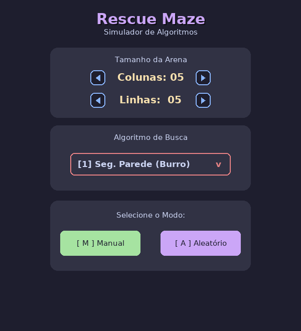
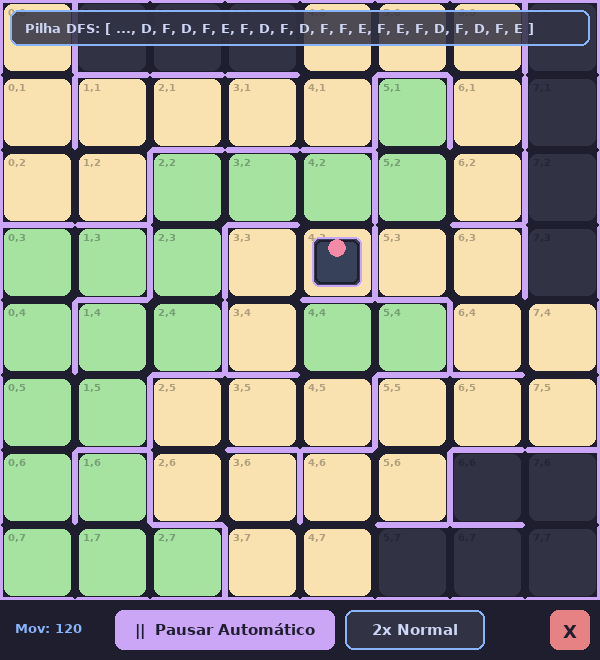
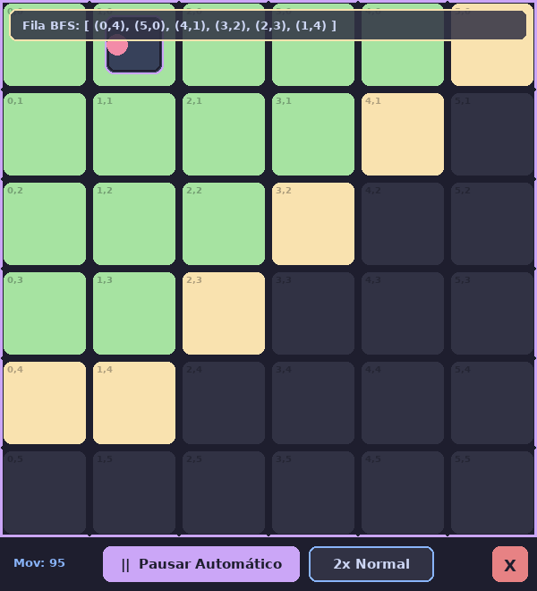
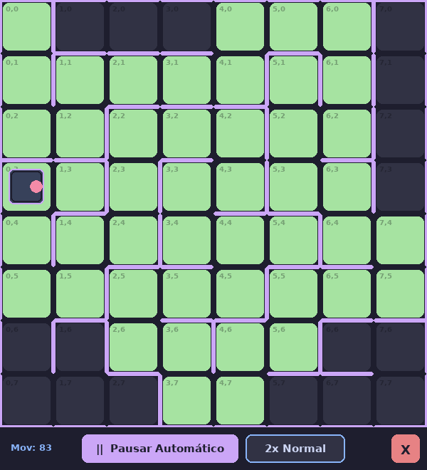

# Rescue Maze Simulator

  

An educational Python + Pygame simulator for **teaching and demonstrating the basic navigation principles used in RoboCup Junior Rescue Maze**. A virtual robot explores a tiled maze with five different strategies, from the most naive wall follower up to breadth-first search (BFS). You can follow every step, with the DFS stack and the BFS queue shown on screen.

🇧🇷 [Versão em português](README.md)

| Menu | DFS (stack shown) | BFS (queue shown) |
|:---:|:---:|:---:|
|  |  |  |

> The interface is in Portuguese. This README translates every label you will see on screen.

---

## Contents

- [Background](#background)
- [Features](#features)
- [Installation](#installation)
- [How to use](#how-to-use)
- [The algorithms](#the-algorithms)
- [Where each algorithm fails](#where-each-algorithm-fails)
- [Efficiency](#efficiency)
- [Tests](#tests)
- [Repository layout](#repository-layout)
- [Extension ideas](#extension-ideas)

---

## Background

In Rescue Maze, an autonomous robot has to explore a maze of square tiles. It decides where to go using only what its sensors detect (walls ahead, to the right, to the left and behind) and what it remembers. Teams usually also want the robot to return to the starting tile once exploration is done.

This simulator isolates **just the navigation problem**:

- the arena is a grid of up to 15×15 tiles;
- the robot always starts in the **(0,0) corner, facing East**;
- sensors are perfect, and the robot only sees the walls of the tile it is on;
- moves are discrete: turn right 90°, turn left 90°, move forward and move backward.

The other competition elements are left out on purpose: ramps, black tiles, checkpoints, victims, and sensor or odometry errors. The competition rules change every year, so always check the official version at [junior.robocup.org](https://junior.robocup.org/).

## Features

- **5 algorithms**: dumb wall follower, wall follower, list-based DFS (explicit stack), recursive DFS and BFS.
- **Two arena modes**: a random maze (generated by recursive backtracking) or one you draw by clicking on the walls.
- **Step-by-step or automatic** runs, with 4 speeds.
- **Data structures on screen**: the DFS move stack and the BFS tile queue appear at the top of the screen.
- **Move counter** for comparing the cost of each algorithm.
- **Switch algorithms on the same maze** after a search finishes, so you can compare strategies on the same layout.
- **Automated tests** and a **benchmark** that run without opening a window.

---

## Installation

### Requirements

- **Python 3.8 or newer** (tested on Python 3.13)
- **pygame 2.0 or newer** (tested on pygame 2.6.1; the code uses `border_radius`, which only exists from pygame 2 on)

### Step by step

**1. Clone the repository**

```bash
git clone https://github.com/<rodr1gofm>/<robocup-maze-basic_navigation_simulator>.git
cd <robocup-maze-basic_navigation_simulator>
```

You can also use GitHub's **Code → Download ZIP** button and extract the archive.

**2. (Recommended) Create a virtual environment**

```bash
python -m venv .venv
```

Activate it:

| System | Command |
|---|---|
| Windows (PowerShell) | `.venv\Scripts\Activate.ps1` |
| Windows (cmd) | `.venv\Scripts\activate.bat` |
| Linux / macOS | `source .venv/bin/activate` |

**3. Install the dependencies**

```bash
pip install -r requirements.txt
```

**4. Run the simulator**

```bash
python simuladorv2.py
```

> On Linux/macOS you may need `python3` instead of `python`.

### Troubleshooting

- **`ModuleNotFoundError: No module named 'pygame'`**: pygame was installed into a different Python. Activate the virtual environment, or run `python -m pip install -r requirements.txt` with the same `python` you use to start the simulator.
- **`pip` can't find a pygame package for your Python version** (common right after a new Python release): use a slightly older Python, or install the compatible fork `pygame-ce` (`pip install pygame-ce`). It is used with the same `import pygame`.
- **The font looks different**: the program asks for *Segoe UI* or *Arial* and uses pygame's default font when neither is installed. This doesn't affect anything else.

---

## How to use

### 1. Start menu

| Action | Mouse | Keyboard |
|---|---|---|
| Change the number of columns, "Colunas" (3 to 15) | ◀ ▶ arrows | `←` / `→` |
| Change the number of rows, "Linhas" (3 to 15) | ◀ ▶ arrows | `↓` / `↑` |
| Choose the algorithm, "Algoritmo de Busca" | click the red box and pick from the list | `1` to `5` |
| Draw the maze yourself | **[ M ] Manual** button | `M` |
| Generate a random maze | **[ A ] Aleatório** button | `A` |

Algorithms: `1` Seg. Parede (Burro), the dumb wall follower · `2` Seguidor de Parede, the wall follower · `3` DFS (Busca em Lista), list-based DFS · `4` DFS (Recursivo), recursive DFS · `5` BFS.

### 2a. Random mode

The maze is generated on the spot with **recursive backtracking**: starting from (0,0), the generator visits neighbors in random order and knocks down walls as it goes. The result is always a **perfect maze**: every tile is reachable, there are no loops, and there is exactly one path between any two tiles.

### 2b. Manual mode

The arena starts **with no inner walls**, only the outer border.

- **Click near the edge of a tile** (within 15 px of it) to add or remove the wall on that side. The wall applies to both neighboring tiles.
- The outer border of the arena can't be changed.
- Press **SPACE** when you're done.

Manual mode is how you build **mazes with loops**, isolated regions and specific cases for showing in class where each algorithm fails (see the examples in [Where each algorithm fails](#where-each-algorithm-fails)).

### 3. Running the search

The robot appears at (0,0). The pink dot marks its front.

| Action | How |
|---|---|
| Start in **step-by-step** mode | `SPACE` |
| Advance one step (in step-by-step mode) | any key |
| Start or resume **automatic** mode | **▶ Rodar Automático** button |
| Pause (back to step-by-step) | **‖ Pausar Automático** button |
| Change the speed (1x Lento, 2x Normal, 3x Rápido, MAX Turbo) | speed button |
| Go back to the menu at any time | red **X** button |

Each "step" is **one robot action**: a 90° turn or a one-tile move. The **Mov** counter adds turns and moves together.

> ⚠️ The two wall followers **have no stopping condition**. They keep running until you click **X**. This is intentional, because it shows one of their limitations (see [below](#where-each-algorithm-fails)).

### 4. After the search finishes (DFS and BFS)

The buttons change:

- **↻ Novo Labirinto** (new maze) goes back to the menu.
- **Trocar Alg.** (switch algorithm) lets you choose another algorithm and runs it again **on the same maze**. This is the best way to compare strategies.

### Color legend

| Color | Meaning |
|---|---|
| Dark gray | tile not visited yet |
| Yellow | **DFS:** visited, but still has paths left to explore · **BFS:** discovered and waiting in the queue |
| Green | **DFS:** complete (every path from it has been explored) · **BFS:** visited · **Wall followers:** marked as complete |
| Lilac | walls |

Banner at the top of the screen:

- **Pilha DFS** (DFS stack, list-based DFS only): the stored moves (`F` forward, `D` right, `E` left), with the 20 most recent on the right.
- **Fila BFS** (BFS queue): the tiles waiting to be visited, in queue order.

---

## The algorithms

All the logic can be read **directly in the code**, in the `# --- ALGORITMOS DE BUSCA ---` section of [`simuladorv2.py`](simuladorv2.py). Each algorithm is a standalone function with the name shown below, and each one takes the same `(robo, arena, tela)` arguments. After every action, the algorithm calls `esperar_tecla(...)`, which draws the screen and waits for the next step. That is why the algorithm code looks very much like the code that would run on a real robot.

> Code identifiers are in Portuguese. Quick glossary: *frente* = front, *direita* = right, *esquerda* = left, *trás* = back, *andar* = move, *virar* = turn, *parede* = wall, *visitados* = visited, *completos* = completed, *próximos* = next (the queue), *origem* = parent.

### Shared building blocks

| Piece | Where | What it does |
|---|---|---|
| `Arena` | [`simuladorv2.py#L44`](simuladorv2.py#L44) | Grid of cells; each cell stores `{'N','E','S','W'}`, with `1` = wall |
| `Arena.gerar_labirinto_aleatorio` | [`#L66`](simuladorv2.py#L66) | Recursive backtracking generator |
| `Robo` | [`#L120`](simuladorv2.py#L120) | Position, heading (0=N, 1=E, 2=S, 3=W) and move counter |
| `virar_direita` / `virar_esquerda` / `andar_frente` / `andar_tras` | [`#L129–151`](simuladorv2.py#L129) | Basic actions; moving into a wall does nothing |
| `verificar_parede_frente/direita/esquerda/tras` | [`#L153–156`](simuladorv2.py#L153) | "Sensors" relative to the robot's heading |
| `proximo_tile_visitado` / `proximo_tile_completo` / `proximo_tile_conhecido` | [`#L333–395`](simuladorv2.py#L333) | Check the robot's memory about the neighbor ahead (0), to the right (1) or to the left (2) |
| `mover_para_vizinho` | [`#L354`](simuladorv2.py#L354) | Turns the robot toward a neighbor and moves there (used by BFS) |

> **Why does no algorithm look behind?** Because when the robot enters a tile, whatever is behind it is always the tile it came from. At the start, behind the robot is the arena's West border, since it starts at (0,0) facing East. So checking front, right and left is enough.

### 1. Dumb wall follower: `seguidor_parede_burro` ([L539](simuladorv2.py#L539))

**Idea:** react only to what the sensors show right now, with no memory at all.

```
repeat forever:
    if front is free:        move forward
    else if right is free:   turn right and move
    else if left is free:    turn left and move
    else:                    move backward (without turning)
```

It's the natural starting point for showing **why a robot needs memory**.

> Note: the priority here is **front → right → left**. The classic "right-hand rule" checks **the right side first**. See [Extension ideas](#extension-ideas).

### 2. Wall follower: `seguidor_parede` ([L557](simuladorv2.py#L557))

**Idea:** the same rule, plus a minimal memory. Before leaving a tile, the robot marks it as **completed** and never again enters a completed tile by moving forward or turning.

```
repeat forever:
    mark current tile as completed
    if front free and not completed:       move
    else if right free and not completed:  turn right and move
    else if left free and not completed:   turn left and move
    else:                                  move backward (without turning)
```

This fixes the dumb follower's back-and-forth in dead ends, but creates a new problem (see the failures).

### 3. List-based DFS: `dfs_lista` ([L487](simuladorv2.py#L487))

**Idea:** depth-first search. The robot follows a path until it has nowhere left to go, then **goes back along the same path** to the last point that still had options. To know how to go back, it stores **its own moves** on a stack (`movimentos_atuais`):

```
mark start as visited
repeat:
    if front free and not visited:       push F; move
    else if right free and not visited:  push D; turn right; push F; move
    else if left free and not visited:   push E; turn left; push F; move
    else:
        mark tile as completed
        if I'm at the start: DONE
        pop the last move and undo it:
            F → move backward    D → turn left    E → turn right
```

The key point: the stack stores **actions** (F, D, E), not coordinates. Going back just means **running the actions backwards, in reverse order**, the same way a real robot would retrace its path. On screen, the stack grows as the robot advances and shrinks as it backs up.

### 4. Recursive DFS: `dfs_recursivo` ([L462](simuladorv2.py#L462))

**Idea:** the same depth-first search, but the way back is stored in the language's **call stack**:

```
dfs():
    mark tile as visited
    for each direction in [front, right, left]:
        if it is free and not visited:
            turn toward it; move
            dfs()                     ← explore everything on that side
            move backward; undo turn  ← come back exactly here
    mark tile as completed
```

The tests show that both DFS versions follow **exactly the same path**. The difference is where the memory lives: in an explicit list or in the recursion. That makes the pair a good way to explain recursion. One small difference: the recursive version undoes the last turn when it returns to the start, so it sometimes makes 1 extra move and ends facing East.

### 5. BFS: `bfs` ([L398](simuladorv2.py#L398))

**Idea:** breadth-first search. The robot visits tiles **in order of distance** from the start: first the neighbors of (0,0), then their neighbors, and so on (the green "wave" in the screenshot above).

Data structures:

- `proximos`: **queue** (`deque`) of tiles that have been discovered but not visited yet. It's the "Fila BFS" shown on screen.
- `origem`: dictionary `tile → tile it was discovered from` (its "parent"). Together these pairs form a **tree** rooted at (0,0).

```
repeat:
    mark current tile as visited
    for each free, still unknown neighbor (front, right, left):
        append it to the queue; origem[neighbor] = current
    if the queue is empty:
        if I'm already back at the start: DONE
        else: append (0,0) to the queue   ← to go back home
    target = first in queue
    find the LOWEST COMMON ANCESTOR of "current" and "target" in the origem tree
    climb from "current" up to the common ancestor   (following origem[])
    walk down from the common ancestor to "target"   (mover_para_vizinho at each step)
    remove "target" from the queue
```

What sets this apart from textbook BFS is that **the robot has to physically travel to every tile in the queue**. Consecutive tiles in the queue are usually on different branches of the maze, so the robot keeps going back and forth. That's why BFS is correct but much more expensive as an exploration strategy (see [Efficiency](#efficiency)).

---

## Where each algorithm fails

Every example below is implemented as a test in [`tests/test_falhas.py`](tests/test_falhas.py), and you can build them in **Manual mode** to show in class. `A ── B` means there is an open passage between two tiles. Tiles without a drawn connection are separated by a wall.

### Dumb wall follower

**1. Endless back-and-forth in the first dead end.** Moving backward doesn't turn the robot. It returns to the previous tile still facing the dead end, and the "front first" rule sends it straight back in.

```
(0,0) ── (1,0) ── (2,0)    ← dead end: the robot bounces between (1,0) and (2,0)
           │
         (1,1)             ← never visited
```

Since random mazes are perfect, **there are always dead ends**. In the tests, the dumb follower ended up in this 2-tile bounce in **100% of the random mazes**.

**2. Circles forever around a loop** (manual mazes). The fixed priority always picks the same exit:

```
(0,0) ── (1,0)
  │        │
(0,1) ── (1,1)
  │
(0,2)              ← never visited: at (0,1), right (North) beats left (South)
```

**3. No stopping condition.** Even when it can't move at all (for example, with (0,0) boxed in by walls), it stays in the loop forever.

### Wall follower (with memory)

**1. Gets stuck when it has to back out through a turn.** Moving backward only undoes straight-line moves. If the robot turned and then entered a dead end, backing up takes it to the corner tile **still facing the dead end**, and from there every option is either "completed" or blocked:

```
(0,0) ── (1,0)
  │        │
(0,1)    (1,1)     (wall between (0,1) and (1,1))
```

Path: (0,0) → (1,0) → turns right → (1,1), which is a dead end → backs up to (1,0), facing South. At (1,0): the front (1,1) is completed, the right (0,0) is completed, the left is the border, and the back (North) is also the border. **The robot stands still forever** and (0,1) is never visited.

**2. No stopping condition and no return to the start.** Even in an open arena, where it does pass through every tile, the robot ends up parked on some tile far from (0,0).

**3. Low coverage in larger mazes.** In the tests it got stuck in **100% of the random mazes**, covering on average 78% of the tiles in 5×5, 59% in 8×8 and only 33% in 15×15.



*The wall follower is parked forever at (0,3). The gray tiles will never be visited.*

### DFS (list-based and recursive)

**Doesn't fail:** in every test (perfect mazes, mazes with loops, open arenas, corridors, a boxed-in start and unreachable regions), both versions visit every reachable tile and return to (0,0). Things to keep in mind:

- **It doesn't find the shortest path**: it explores, it doesn't optimize routes.
- **Recursion:** the recursive DFS uses one recursion level per tile on the current path. At the menu's limit (15×15 = 225) that is well below Python's default limit (1000), but raising the maximum arena size a lot would cause a `RecursionError`. The maze generator is recursive too.
- The list-based DFS can finish with a leftover `D` on the stack and the robot facing South, because it stops as soon as it reaches the start, without undoing the first turn. This doesn't affect exploration.

### BFS

**Correctness is fine**: it visits everything, in order of distance, and returns to the start in every test. Its problem is **cost**:

- The robot drives to every tile in the queue, so it crosses the maze many times (6.5× more moves than DFS on 15×15).
- It only moves along the edges of the **BFS tree** (`origem`). In mazes with loops it doesn't take shortcuts, so the cost gets even worse (7.9× DFS on 15×15 with loops).

---

## Efficiency

Numbers from `python tests/benchmark.py`: the average over 50 random (perfect) mazes per size, with the same mazes used for every algorithm.

- **moves** = tile-to-tile moves
- **mov** = the on-screen counter (moves + turns)
- **× DFS** = moves relative to DFS on the same maze

| Arena | Algorithm | Finishes | Coverage | mov | moves | × DFS |
|---|---|:---:|:---:|---:|---:|---:|
| 5×5 (25) | Dumb wall follower | 0% | 68% | — | — | — |
| | Wall follower | 0% | 78% | — | — | — |
| | DFS (list) | 100% | 100% | 78.5 | 48.0 | 1.00 |
| | DFS (recursive) | 100% | 100% | 79.0 | 48.0 | 1.00 |
| | BFS | 100% | 100% | 124.9 | 72.8 | 1.52 |
| 8×8 (64) | Dumb wall follower | 0% | 44% | — | — | — |
| | Wall follower | 0% | 59% | — | — | — |
| | DFS (list) | 100% | 100% | 205.4 | 126.0 | 1.00 |
| | DFS (recursive) | 100% | 100% | 205.9 | 126.0 | 1.00 |
| | BFS | 100% | 100% | 493.7 | 293.7 | 2.33 |
| 10×10 (100) | DFS (list) | 100% | 100% | 323.3 | 198.0 | 1.00 |
| | BFS | 100% | 100% | 1077.1 | 650.1 | 3.28 |
| 15×15 (225) | Dumb wall follower | 0% | 19% | — | — | — |
| | Wall follower | 0% | 33% | — | — | — |
| | DFS (list) | 100% | 100% | 738.0 | 448.0 | 1.00 |
| | DFS (recursive) | 100% | 100% | 738.5 | 448.0 | 1.00 |
| | BFS | 100% | 100% | 4796.1 | 2909.5 | 6.49 |

With loops (10 extra walls removed), DFS stays at 126 and 448 moves on 8×8 and 15×15. BFS rises to 4.1× and 7.9× DFS.

### Notes

- **DFS is optimal for exploring and returning.** In a maze with *N* reachable tiles, it makes exactly **2·(N−1) moves**: every passage is crossed once going out and once coming back. That is the **lowest possible** number of moves for visiting every tile and returning to the start in a perfect maze, and a test checks it. With loops, it ignores the extra passages and keeps the same cost.
- **BFS gets worse as the arena grows.** For each tile in the queue, the robot climbs to the common ancestor and walks down again, so the cost grows with *tiles × depth* instead of just with the number of tiles. The gap is small on 3×3 (1.08×) and huge on 15×15 (6.5×). In a corridor with no branches, BFS and DFS tie.
- **Lesson for the competition:** BFS is excellent for **computing** the shortest path on a map that is already in memory (for example, planning the way back to the start or reaching the nearest unexplored tile). It is a poor **physical exploration order**. The usual combination is to explore with DFS and plan routes with BFS over the map that has been built.
- **Turns cost too.** The `Mov` counter gives turns and moves a weight of 1 each. In DFS, about 40% of the actions are turns. On a real robot, turning and driving take different amounts of time, so it's worth weighting the two when comparing algorithms.
- **Memory:** the dumb follower uses none. The wall follower uses the `completos` list, which is checked with `in` and collects duplicates (O(n) per lookup; a `set` would be O(1)). DFS uses O(N) for the stack or the recursion. BFS uses O(N) for the queue and the `origem` dictionary. With at most 225 tiles, none of these differences affects run time, but they are good points for class discussion.

---

## Tests

The tests run **without opening a window**: pygame starts with `SDL_VIDEODRIVER=dummy`, and the `esperar_tecla` function is replaced by an observer that, after every robot action:

- records the position and heading;
- checks that the robot **didn't pass through a wall** or leave the arena;
- stops the run after a set number of actions, so the wall followers, which never finish, can't hang the tests.

The simulator code itself isn't modified.

### How to run

```bash
pip install pytest
pytest
```

Expected output: `283 passed, 6 xfailed`. The 6 `xfailed` are **expected failures**: tests that describe what we would like the wall followers to do (explore the whole maze) and that they can't do. If those tests ever start passing, pytest will flag it, because they are marked `strict=True`.

### What each file covers

| File | Contents |
|---|---|
| [`tests/simulacao.py`](tests/simulacao.py) | Helpers: run an algorithm without the UI, build arenas from paths (`arena_de_caminhos`), generate mazes with loops, compute distances |
| [`tests/test_arena_robo.py`](tests/test_arena_robo.py) | Arena borders, perfect random mazes (every cell reachable, N−1 passages, consistent walls), turns, relative sensors and moves blocked by walls |
| [`tests/test_algoritmos.py`](tests/test_algoritmos.py) | DFS and BFS finish, cover everything and return to (0,0) in many scenarios; DFS makes 2·(N−1) moves; list DFS ≡ recursive DFS; front → right → left priority; BFS visits in distance order; BFS ≥ DFS in moves |
| [`tests/test_falhas.py`](tests/test_falhas.py) | The minimal wall-follower failure examples described above |
| [`tests/benchmark.py`](tests/benchmark.py) | Produces the efficiency table |

### Benchmark

```bash
python tests/benchmark.py                          # 3x3, 5x5, 8x8, 10x10 and 15x15, 50 mazes each
python tests/benchmark.py --tamanhos 6 12 --amostras 200
python tests/benchmark.py --ciclos 10              # remove 10 extra walls (adds loops)
```

### Testing your own algorithm

Write a function with the same `(robo, arena, tela)` signature that calls `esperar_tecla(robo, arena, tela)` after every action. Then:

```python
from simulacao import executar, labirinto_aleatorio
res = executar(my_function, labirinto_aleatorio(8, 8, semente=1))
print(res)  # Resultado(terminou=..., mov=..., desloc=..., giros=..., cobertura=...)
```

To make it show up in the simulator, add it to the `algoritmos` lists in `tela_inicio` and `tela_escolher_algoritmo`.

---

## Repository layout

```
.
├── simuladorv2.py          # the simulator (UI + algorithms)
├── requirements.txt        # runtime dependencies
├── pytest.ini              # test configuration
├── README.md               # Portuguese README
├── README.en.md            # this file (English)
├── docs/img/               # screenshots used in the READMEs
└── tests/
    ├── simulacao.py        # helpers for running without the UI
    ├── test_arena_robo.py
    ├── test_algoritmos.py
    ├── test_falhas.py
    └── benchmark.py
```

---

## Extension ideas

Good classroom exercises, or starting points for contributors:

- **Classic right-hand rule** (right → front → left → U-turn). In a perfect maze it visits everything and returns to the entrance, but it still has no stopping condition and fails on "islands" (loops).
- **Explore with DFS + return with BFS**: after exploring, compute the shortest path back to (0,0) in memory.
- **Greedy exploration**: always head to the nearest unvisited tile, using BFS on the known map.
- Choosing the **starting tile and heading**.
- **Different weights** for turns and moves in the counter.
- Competition elements: black (forbidden) tiles, checkpoints and sensor noise.
