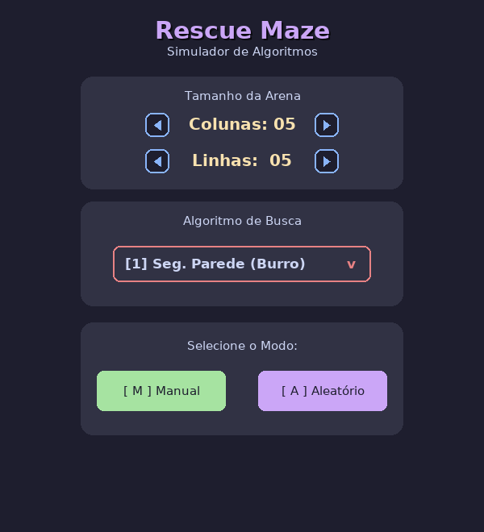
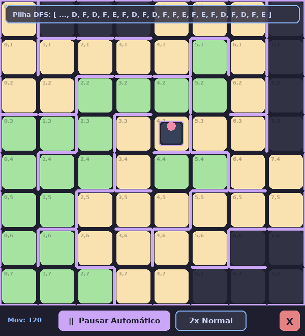
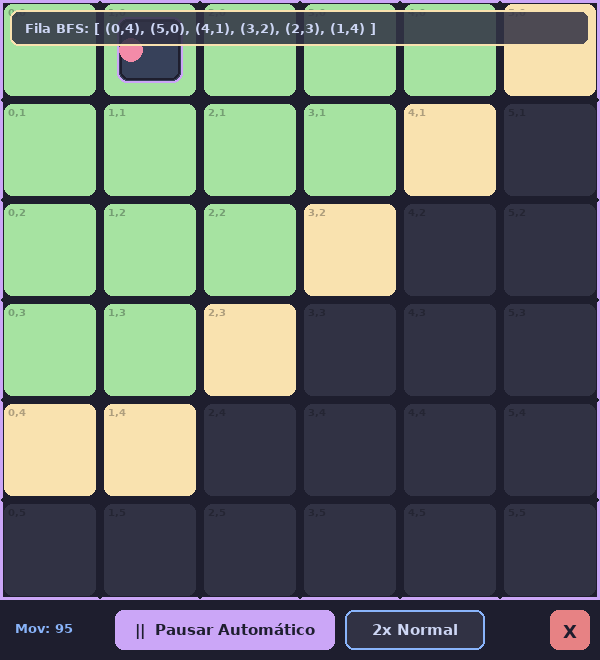
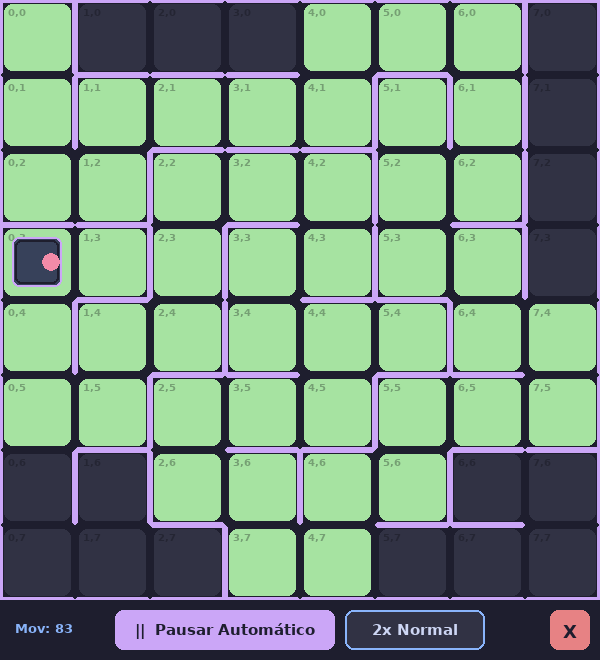

# Rescue Maze Simulator

  

Simulador didático, feito em Python + Pygame, para **ensinar e demonstrar os princípios básicos de navegação usados na RoboCup Junior Rescue Maze**. Um robô virtual explora um labirinto de ladrilhos usando cinco estratégias diferentes, do seguidor de parede mais ingênuo até a busca em largura (BFS). Dá para acompanhar tudo passo a passo, com a pilha da DFS e a fila da BFS aparecendo na tela.

🇺🇸 [English version](README.en.md)

| Menu | DFS (pilha visível) | BFS (fila visível) |
|:---:|:---:|:---:|
|  |  |  |

---

## Sumário

- [Contexto](#contexto)
- [Funcionalidades](#funcionalidades)
- [Instalação](#instalação)
- [Como usar](#como-usar)
- [Os algoritmos](#os-algoritmos)
- [Onde cada algoritmo falha](#onde-cada-algoritmo-falha)
- [Eficiência](#eficiência)
- [Testes](#testes)
- [Estrutura do repositório](#estrutura-do-repositório)
- [Ideias de extensão](#ideias-de-extensão)

---

## Contexto

Na Rescue Maze, um robô autônomo precisa explorar um labirinto de ladrilhos quadrados, decidindo por onde ir apenas com o que seus sensores detectam (paredes à frente, à direita, à esquerda e atrás) e com o que ele mesmo lembra. Em geral, a equipe também quer que ele volte ao ladrilho inicial no final da exploração.

Este simulador isola **só o problema de navegação**:

- a arena é uma grade de até 15×15 ladrilhos;
- o robô sempre começa no canto **(0,0), virado para Leste**;
- os sensores são perfeitos e o robô só enxerga as paredes do ladrilho onde está;
- os movimentos são discretos: girar 90° à direita, girar 90° à esquerda, andar para frente e andar de ré.

Ficam de fora, de propósito, os outros elementos da competição: rampas, ladrilhos pretos, checkpoints, vítimas e erros de sensor ou de odometria. As regras da competição mudam todo ano, então consulte sempre a versão oficial em [junior.robocup.org](https://junior.robocup.org/).

## Funcionalidades

- **5 algoritmos**: Seguidor de Parede (Burro), Seguidor de Parede, DFS com lista (pilha explícita), DFS recursiva e BFS.
- **Dois modos de arena**: labirinto aleatório (gerado por *backtracking* recursivo) ou desenhado à mão, clicando nas paredes.
- **Passo a passo ou automático**, com 4 velocidades.
- **Estruturas de dados visíveis**: a pilha de movimentos da DFS e a fila de ladrilhos da BFS aparecem no topo da tela.
- **Contador de movimentos** para comparar o custo de cada algoritmo.
- **Trocar de algoritmo no mesmo labirinto** depois que uma busca termina, para comparar as estratégias no mesmo cenário.
- **Testes automatizados** e um **benchmark** que rodam sem abrir janela.

---

## Instalação

### Requisitos

- **Python 3.8 ou mais recente** (testado com Python 3.13)
- **pygame 2.0 ou mais recente** (testado com pygame 2.6.1; o código usa `border_radius`, que só existe a partir do pygame 2)

### Passo a passo

**1. Clone o repositório**

```bash
git clone https://github.com/<rodr1gofm>/<robocup-maze-basic_navigation_simulator>.git
cd <robocup-maze-basic_navigation_simulator>
```

Se preferir, baixe o ZIP pelo botão **Code → Download ZIP** do GitHub e extraia.

**2. (Recomendado) Crie um ambiente virtual**

```bash
python -m venv .venv
```

Ative o ambiente:

| Sistema | Comando |
|---|---|
| Windows (PowerShell) | `.venv\Scripts\Activate.ps1` |
| Windows (cmd) | `.venv\Scripts\activate.bat` |
| Linux / macOS | `source .venv/bin/activate` |

**3. Instale as dependências**

```bash
pip install -r requirements.txt
```

**4. Rode o simulador**

```bash
python simuladorv2.py
```

> No Linux/macOS, pode ser necessário usar `python3` no lugar de `python`.

### Problemas comuns

- **`ModuleNotFoundError: No module named 'pygame'`**: o pygame foi instalado em outro Python. Ative o ambiente virtual ou rode `python -m pip install -r requirements.txt` com o mesmo `python` que você usa para rodar o simulador.
- **O `pip` não encontra um pacote do pygame para a sua versão do Python** (comum logo após o lançamento de uma versão nova): use uma versão um pouco anterior do Python ou instale o fork compatível `pygame-ce` (`pip install pygame-ce`). Ele é usado com o mesmo `import pygame`.
- **A fonte ficou diferente**: o programa pede *Segoe UI* ou *Arial* e usa a fonte padrão do pygame se nenhuma das duas existir. Isso não afeta o funcionamento.

---

## Como usar

### 1. Menu inicial

| Ação | Mouse | Teclado |
|---|---|---|
| Mudar número de colunas (3 a 15) | setas ◀ ▶ de "Colunas" | `←` / `→` |
| Mudar número de linhas (3 a 15) | setas ◀ ▶ de "Linhas" | `↓` / `↑` |
| Escolher o algoritmo | clique na caixa vermelha e escolha na lista | `1` a `5` |
| Montar o labirinto à mão | botão **[ M ] Manual** | `M` |
| Gerar um labirinto aleatório | botão **[ A ] Aleatório** | `A` |

Algoritmos: `1` Seg. Parede (Burro) · `2` Seguidor de Parede · `3` DFS (Busca em Lista) · `4` DFS (Recursivo) · `5` BFS.

### 2a. Modo Aleatório

O labirinto é gerado na hora com **backtracking recursivo**: ele parte de (0,0), escolhe vizinhos em ordem aleatória e vai derrubando paredes. O resultado é sempre um **labirinto perfeito**, ou seja, todos os ladrilhos são alcançáveis, não há ciclos e existe exatamente um caminho entre dois ladrilhos quaisquer.

### 2b. Modo Manual

A arena começa **sem nenhuma parede interna**, só com as bordas externas.

- **Clique perto da borda de um ladrilho** (até 15 px da borda) para colocar ou tirar a parede daquele lado. A parede vale para os dois ladrilhos vizinhos.
- As bordas externas da arena são fixas.
- Aperte **ESPAÇO** quando terminar.

O modo manual é o jeito de criar **labirintos com ciclos**, regiões isoladas e casos específicos para mostrar em aula onde cada algoritmo falha (veja os exemplos na seção [Onde cada algoritmo falha](#onde-cada-algoritmo-falha)).

### 3. Executando a busca

O robô aparece em (0,0). A bolinha rosa indica a frente dele.

| Ação | Como |
|---|---|
| Começar no modo **passo a passo** | `ESPAÇO` |
| Avançar um passo (no passo a passo) | qualquer tecla |
| Começar ou retomar o modo **automático** | botão **▶ Rodar Automático** |
| Pausar (volta ao passo a passo) | botão **‖ Pausar Automático** |
| Mudar a velocidade (1x Lento, 2x Normal, 3x Rápido, MAX Turbo) | botão de velocidade |
| Voltar ao menu a qualquer momento | botão vermelho **X** |

Cada "passo" é **uma ação do robô**: um giro de 90° ou um deslocamento de um ladrilho. O contador **Mov** soma giros e deslocamentos.

> ⚠️ Os dois seguidores de parede **não têm condição de parada**. Eles rodam até você clicar em **X**. Isso é intencional, porque mostra uma das limitações deles (veja [abaixo](#onde-cada-algoritmo-falha)).

### 4. Depois que a busca termina (DFS e BFS)

Os botões mudam:

- **↻ Novo Labirinto** volta ao menu.
- **Trocar Alg.** escolhe outro algoritmo e roda de novo **no mesmo labirinto**. É a melhor forma de comparar estratégias.

### Legenda de cores

| Cor | Significado |
|---|---|
| Cinza escuro | ladrilho ainda não visitado |
| Amarelo | **DFS:** visitado, mas ainda com caminhos pendentes · **BFS:** descoberto e esperando na fila |
| Verde | **DFS:** completo (todos os caminhos a partir dele foram explorados) · **BFS:** visitado · **Seguidores:** marcado como completo |
| Lilás | paredes |

Faixa no topo da tela:

- **Pilha DFS** (só na DFS em lista): os movimentos guardados (`F` frente, `D` direita, `E` esquerda), com os 20 mais recentes à direita.
- **Fila BFS**: os ladrilhos esperando para serem visitados, na ordem da fila.

---

## Os algoritmos

Toda a lógica pode ser consultada **diretamente no código**, na seção `# --- ALGORITMOS DE BUSCA ---` de [`simuladorv2.py`](simuladorv2.py). Cada algoritmo é uma função independente, com o nome indicado abaixo, e recebe o mesmo trio `(robo, arena, tela)`. Depois de cada ação, o algoritmo chama `esperar_tecla(...)`, que desenha a tela e espera o próximo passo. Por isso o código dos algoritmos fica bem parecido com o código que rodaria num robô de verdade.

### Peças em comum

| Peça | Onde | O que faz |
|---|---|---|
| `Arena` | [`simuladorv2.py#L44`](simuladorv2.py#L44) | Grade de células; cada célula guarda `{'N','E','S','W'}` com `1` = parede |
| `Arena.gerar_labirinto_aleatorio` | [`#L66`](simuladorv2.py#L66) | Gerador por *backtracking* recursivo |
| `Robo` | [`#L120`](simuladorv2.py#L120) | Posição, direção (0=N, 1=E, 2=S, 3=W) e contador de movimentos |
| `virar_direita` / `virar_esquerda` / `andar_frente` / `andar_tras` | [`#L129–151`](simuladorv2.py#L129) | Ações básicas; andar contra uma parede não faz nada |
| `verificar_parede_frente/direita/esquerda/tras` | [`#L153–156`](simuladorv2.py#L153) | "Sensores" relativos à direção do robô |
| `proximo_tile_visitado` / `proximo_tile_completo` / `proximo_tile_conhecido` | [`#L333–395`](simuladorv2.py#L333) | Consultam a memória do robô sobre o vizinho à frente (0), à direita (1) ou à esquerda (2) |
| `mover_para_vizinho` | [`#L354`](simuladorv2.py#L354) | Gira o robô na direção de um vizinho e anda até ele (usado pela BFS) |

> **Por que nenhum algoritmo olha para trás?** Porque, ao entrar em um ladrilho, o que está atrás é sempre o ladrilho de onde o robô veio. No início, atrás do robô fica a borda Oeste da arena, já que ele começa em (0,0) virado para Leste. Assim basta testar frente, direita e esquerda.

### 1. Seguidor de Parede (Burro): `seguidor_parede_burro` ([L539](simuladorv2.py#L539))

**Ideia:** reagir só ao que os sensores mostram agora, sem nenhuma memória.

```
repita para sempre:
    se a frente está livre:      andar para frente
    senão se a direita está livre:  girar à direita e andar
    senão se a esquerda está livre: girar à esquerda e andar
    senão:                         andar de ré (sem girar)
```

É o ponto de partida natural para mostrar **por que um robô precisa de memória**.

> Observação: a prioridade aqui é **frente → direita → esquerda**. A "regra da mão direita" clássica testa **a direita primeiro**. Veja a seção [Ideias de extensão](#ideias-de-extensão).

### 2. Seguidor de Parede: `seguidor_parede` ([L557](simuladorv2.py#L557))

**Ideia:** a mesma regra, mas com uma memória mínima. Antes de sair de um ladrilho, o robô o marca como **completo** e nunca mais entra em um ladrilho completo andando para frente ou fazendo curva.

```
repita para sempre:
    marcar o ladrilho atual como completo
    se frente livre e não completa:      andar
    senão se direita livre e não completa:  girar à direita e andar
    senão se esquerda livre e não completa: girar à esquerda e andar
    senão:                                 andar de ré (sem girar)
```

Isso resolve o vai-e-vem do seguidor burro nos becos sem saída, mas cria um problema novo (veja as falhas).

### 3. DFS (Busca em Lista): `dfs_lista` ([L487](simuladorv2.py#L487))

**Ideia:** busca em profundidade. O robô segue por um caminho até não ter mais para onde ir e então **volta pelo mesmo caminho** até o último ponto que ainda tinha opções. Para saber como voltar, ele guarda **os próprios movimentos** numa pilha (`movimentos_atuais`):

```
marcar início como visitado
repita:
    se frente livre e não visitada:       empilhar F; andar
    senão se direita livre e não visitada:   empilhar D; girar à direita; empilhar F; andar
    senão se esquerda livre e não visitada:  empilhar E; girar à esquerda; empilhar F; andar
    senão:
        marcar ladrilho como completo
        se estou no início: FIM
        desempilhar o último movimento e desfazê-lo:
            F → andar de ré      D → girar à esquerda      E → girar à direita
```

O ponto principal: a pilha guarda **ações** (F, D, E), e não coordenadas. Voltar é só **executar as ações ao contrário, na ordem inversa**, do mesmo jeito que um robô real refaria o próprio caminho. Na tela, a pilha cresce quando o robô avança e diminui quando ele recua.

### 4. DFS (Recursivo): `dfs_recursivo` ([L462](simuladorv2.py#L462))

**Ideia:** a mesma busca em profundidade, mas quem guarda o caminho de volta é a **pilha de chamadas** da linguagem:

```
dfs():
    marcar ladrilho como visitado
    para cada direção em [frente, direita, esquerda]:
        se está livre e não visitada:
            girar para ela; andar
            dfs()                        ← explora tudo daquele lado
            andar de ré; desfazer o giro ← volta exatamente para cá
    marcar ladrilho como completo
```

Os testes mostram que as duas DFS fazem **exatamente o mesmo trajeto**. A diferença está em onde fica a memória: numa lista explícita ou na recursão. Isso torna as duas versões uma boa dupla para explicar recursão. Uma pequena diferença: a recursiva desfaz o último giro ao voltar ao início, então às vezes faz 1 movimento a mais e termina virada para Leste.

### 5. BFS: `bfs` ([L398](simuladorv2.py#L398))

**Ideia:** busca em largura. O robô visita os ladrilhos **em ordem de distância** até o início: primeiro os vizinhos de (0,0), depois os vizinhos dos vizinhos, e assim por diante (a "onda" verde na imagem acima).

Estruturas usadas:

- `proximos`: **fila** (`deque`) de ladrilhos descobertos que ainda não foram visitados. É a "Fila BFS" da tela.
- `origem`: dicionário `ladrilho → ladrilho de onde ele foi descoberto` (o "pai"). Juntos, esses pares formam uma **árvore** com raiz em (0,0).

```
repita:
    marcar ladrilho atual como visitado
    para cada vizinho livre (frente, direita, esquerda) ainda desconhecido:
        colocar no fim da fila; origem[vizinho] = atual
    se a fila está vazia:
        se já voltei para o início: FIM
        senão: colocar (0,0) na fila   ← para voltar para casa
    alvo = primeiro da fila
    achar o ANCESTRAL COMUM entre "atual" e "alvo" na árvore de origem
    subir de "atual" até o ancestral comum   (seguindo origem[])
    descer do ancestral comum até "alvo"     (mover_para_vizinho a cada passo)
    tirar "alvo" da fila
```

A diferença para a BFS dos livros é que aqui **o robô precisa ir fisicamente até cada ladrilho da fila**. Como os ladrilhos consecutivos da fila costumam estar em ramos diferentes do labirinto, o robô vive indo e voltando. Por isso a BFS é correta, mas muito mais cara como estratégia de exploração (veja [Eficiência](#eficiência)).

---

## Onde cada algoritmo falha

Todos os exemplos abaixo estão implementados como testes em [`tests/test_falhas.py`](tests/test_falhas.py) e podem ser montados no **modo Manual** para mostrar em aula. A notação `A ── B` indica passagem livre entre dois ladrilhos. Ladrilhos sem ligação desenhada estão separados por parede.

### Seguidor de Parede (Burro)

**1. Vai-e-vem eterno no primeiro beco sem saída.** A ré não gira o robô. Ele volta ao ladrilho anterior ainda olhando para o beco, e a regra "frente primeiro" o manda de volta para lá.

```
(0,0) ── (1,0) ── (2,0)    ← beco: o robô fica indo e voltando entre (1,0) e (2,0)
           │
         (1,1)             ← nunca é visitado
```

Como o labirinto aleatório é perfeito, **sempre há becos**. Nos testes, o seguidor burro acabou nesse vai-e-vem de 2 ladrilhos em **100% dos labirintos aleatórios**.

**2. Dá voltas para sempre em um ciclo** (labirintos manuais). A prioridade fixa faz o robô escolher sempre a mesma saída:

```
(0,0) ── (1,0)
  │        │
(0,1) ── (1,1)
  │
(0,2)              ← nunca é visitado: em (0,1) a direita (Norte) ganha da esquerda (Sul)
```

**3. Não tem condição de parada.** Mesmo quando não consegue se mover (por exemplo, com (0,0) cercado por paredes), ele fica no laço para sempre.

### Seguidor de Parede (com memória)

**1. Trava quando precisa voltar fazendo uma curva.** A ré só desfaz movimentos em linha reta. Se o robô virou e depois entrou num beco, a ré o leva de volta ao ladrilho da curva **ainda virado para o beco**, e ali todas as opções estão "completas" ou bloqueadas:

```
(0,0) ── (1,0)
  │        │
(0,1)    (1,1)     (parede entre (0,1) e (1,1))
```

Trajeto: (0,0) → (1,0) → gira à direita → (1,1), que é beco → ré para (1,0), virado para o Sul. Em (1,0): a frente (1,1) está completa, a direita (0,0) está completa, a esquerda é borda e a traseira (Norte) também é borda. **O robô fica parado para sempre** e (0,1) nunca é visitado.

**2. Não tem condição de parada e não volta ao início.** Mesmo numa arena aberta, onde ele passa por todos os ladrilhos, o robô depois fica parado em algum ladrilho longe de (0,0).

**3. Pouca cobertura em labirintos maiores.** Nos testes ele travou em **100% dos labirintos aleatórios**, cobrindo em média 78% dos ladrilhos em 5×5, 59% em 8×8 e só 33% em 15×15.



*Seguidor de Parede parado para sempre em (0,3). Os ladrilhos cinza nunca serão visitados.*

### DFS (lista e recursiva)

**Não falha:** em todos os testes (labirintos perfeitos, com ciclos, arenas abertas, corredores, início isolado e regiões inalcançáveis), as duas versões visitam todos os ladrilhos alcançáveis e voltam a (0,0). Pontos de atenção:

- **Não encontra o menor caminho**: ela explora, não otimiza rotas.
- **Recursão:** a DFS recursiva usa um nível de recursão por ladrilho do caminho atual. No limite do menu (15×15 = 225) isso fica bem abaixo do limite padrão do Python (1000), mas aumentar muito o tamanho máximo da arena causaria `RecursionError`. O gerador de labirintos também é recursivo.
- A DFS em lista pode terminar com um `D` sobrando na pilha e o robô virado para o Sul, porque ela para assim que chega ao início, sem desfazer o primeiro giro. Isso não afeta a exploração.

### BFS

**Não falha em correção**: visita tudo, em ordem de distância, e volta ao início em todos os testes. O problema dela é o **custo**:

- O robô anda até cada ladrilho da fila, então percorre o labirinto muitas vezes (6,5× mais deslocamentos que a DFS em 15×15).
- Ele só se move pelas arestas da **árvore da BFS** (`origem`). Em labirintos com ciclos, não aproveita atalhos, e o custo piora ainda mais (7,9× a DFS em 15×15 com ciclos).

---

## Eficiência

Números obtidos com `python tests/benchmark.py`: média de 50 labirintos aleatórios (perfeitos) por tamanho, sempre os mesmos labirintos para todos os algoritmos.

- **desloc** = deslocamentos (trocas de ladrilho)
- **mov** = contador da tela (deslocamentos + giros)
- **× DFS** = deslocamentos em relação à DFS no mesmo labirinto

| Arena | Algoritmo | Termina | Cobertura | mov | desloc | × DFS |
|---|---|:---:|:---:|---:|---:|---:|
| 5×5 (25) | Seg. Parede (Burro) | 0% | 68% | — | — | — |
| | Seguidor de Parede | 0% | 78% | — | — | — |
| | DFS (lista) | 100% | 100% | 78,5 | 48,0 | 1,00 |
| | DFS (recursiva) | 100% | 100% | 79,0 | 48,0 | 1,00 |
| | BFS | 100% | 100% | 124,9 | 72,8 | 1,52 |
| 8×8 (64) | Seg. Parede (Burro) | 0% | 44% | — | — | — |
| | Seguidor de Parede | 0% | 59% | — | — | — |
| | DFS (lista) | 100% | 100% | 205,4 | 126,0 | 1,00 |
| | DFS (recursiva) | 100% | 100% | 205,9 | 126,0 | 1,00 |
| | BFS | 100% | 100% | 493,7 | 293,7 | 2,33 |
| 10×10 (100) | DFS (lista) | 100% | 100% | 323,3 | 198,0 | 1,00 |
| | BFS | 100% | 100% | 1077,1 | 650,1 | 3,28 |
| 15×15 (225) | Seg. Parede (Burro) | 0% | 19% | — | — | — |
| | Seguidor de Parede | 0% | 33% | — | — | — |
| | DFS (lista) | 100% | 100% | 738,0 | 448,0 | 1,00 |
| | DFS (recursiva) | 100% | 100% | 738,5 | 448,0 | 1,00 |
| | BFS | 100% | 100% | 4796,1 | 2909,5 | 6,49 |

Com ciclos (10 paredes extras removidas), a DFS continua com 126 e 448 deslocamentos em 8×8 e 15×15. A BFS sobe para 4,1× e 7,9× a DFS.

### Observações

- **A DFS é ótima para explorar e voltar.** Num labirinto com *N* ladrilhos alcançáveis, ela faz exatamente **2·(N−1) deslocamentos**: cada passagem é atravessada uma vez na ida e uma na volta. Esse é o **mínimo possível** para visitar todos os ladrilhos e voltar ao início num labirinto perfeito, e um teste verifica isso. Com ciclos, ela ignora as passagens extras e mantém o mesmo custo.
- **A BFS piora conforme a arena cresce.** Para cada ladrilho da fila, o robô sobe até o ancestral comum e desce de novo, então o custo cresce com *ladrilhos × profundidade* e não só com o número de ladrilhos. A diferença é pequena em 3×3 (1,08×) e enorme em 15×15 (6,5×). Em um corredor sem bifurcações, BFS e DFS empatam.
- **Lição para a competição:** a BFS é excelente para **calcular** o menor caminho num mapa que já está na memória (por exemplo, planejar a volta ao início ou ir até o ladrilho não explorado mais próximo). Ela é ruim como **ordem física de exploração**. A combinação comum é explorar com DFS e planejar rotas com BFS sobre o mapa já construído.
- **Giros também custam.** O contador `Mov` dá peso 1 a giros e deslocamentos. Na DFS, cerca de 40% das ações são giros. Num robô real, girar e andar levam tempos diferentes, então vale ponderar os dois ao comparar algoritmos.
- **Memória:** o seguidor burro não usa nenhuma. O seguidor usa a lista `completos`, que é consultada com `in` e acumula repetições (custo O(n) por consulta; um `set` seria O(1)). A DFS usa O(N) na pilha ou na recursão. A BFS usa O(N) para a fila e para o dicionário `origem`. Com no máximo 225 ladrilhos, nenhuma dessas diferenças pesa no tempo de execução, mas são boas para discutir em aula.

---

## Testes

Os testes rodam **sem abrir janela**: o pygame é iniciado com `SDL_VIDEODRIVER=dummy` e a função `esperar_tecla` é trocada por um observador que, a cada ação do robô:

- registra a posição e a direção;
- confirma que o robô **não atravessou nenhuma parede** nem saiu da arena;
- interrompe a execução depois de um limite de ações, para que os seguidores de parede, que nunca terminam, não travem os testes.

O código do simulador não é alterado.

### Como rodar

```bash
pip install pytest
pytest
```

Resultado esperado: `283 passed, 6 xfailed`. Os 6 `xfailed` são **falhas esperadas**: testes que descrevem o que gostaríamos que os seguidores de parede fizessem (explorar o labirinto inteiro) e que eles não conseguem. Se um dia esses testes passarem, o pytest avisa, porque estão marcados com `strict=True`.

### O que cada arquivo testa

| Arquivo | Conteúdo |
|---|---|
| [`tests/simulacao.py`](tests/simulacao.py) | Utilitários: rodar um algoritmo sem interface, montar arenas a partir de caminhos (`arena_de_caminhos`), gerar labirintos com ciclos, calcular distâncias |
| [`tests/test_arena_robo.py`](tests/test_arena_robo.py) | Bordas da arena, labirinto aleatório perfeito (todas as células alcançáveis, N−1 passagens, paredes coerentes), giros, sensores relativos e movimentos bloqueados por parede |
| [`tests/test_algoritmos.py`](tests/test_algoritmos.py) | DFS e BFS terminam, cobrem tudo e voltam a (0,0) em vários cenários; DFS faz 2·(N−1) deslocamentos; DFS lista ≡ recursiva; prioridade frente → direita → esquerda; BFS visita em ordem de distância; BFS ≥ DFS em deslocamentos |
| [`tests/test_falhas.py`](tests/test_falhas.py) | Os exemplos mínimos de falha dos seguidores de parede descritos acima |
| [`tests/benchmark.py`](tests/benchmark.py) | Gera a tabela de eficiência |

### Benchmark

```bash
python tests/benchmark.py                          # 3x3, 5x5, 8x8, 10x10 e 15x15, 50 labirintos cada
python tests/benchmark.py --tamanhos 6 12 --amostras 200
python tests/benchmark.py --ciclos 10              # remove 10 paredes extras (cria ciclos)
```

### Testando o seu próprio algoritmo

Escreva uma função com a mesma assinatura `(robo, arena, tela)` que chame `esperar_tecla(robo, arena, tela)` depois de cada ação. Depois:

```python
from simulacao import executar, labirinto_aleatorio
res = executar(minha_funcao, labirinto_aleatorio(8, 8, semente=1))
print(res)  # Resultado(terminou=..., mov=..., desloc=..., giros=..., cobertura=...)
```

Para que ela apareça no simulador, adicione-a às listas `algoritmos` de `tela_inicio` e `tela_escolher_algoritmo`.

---

## Estrutura do repositório

```
.
├── simuladorv2.py          # o simulador (interface + algoritmos)
├── requirements.txt        # dependências para rodar
├── pytest.ini              # configuração dos testes
├── README.md               # este arquivo (português)
├── README.en.md            # versão em inglês
├── docs/img/               # capturas de tela usadas no README
└── tests/
    ├── simulacao.py        # utilitários para rodar sem interface
    ├── test_arena_robo.py
    ├── test_algoritmos.py
    ├── test_falhas.py
    └── benchmark.py
```

---

## Ideias de extensão

Boas atividades para aula ou para quem quiser contribuir:

- **Regra da mão direita clássica** (direita → frente → esquerda → meia-volta). Num labirinto perfeito ela visita tudo e volta à entrada, mas também não tem condição de parada e falha com "ilhas" (ciclos).
- **Exploração com DFS + volta com BFS**: depois de explorar, calcular na memória o menor caminho até (0,0).
- **Exploração "gulosa"**: ir sempre até o ladrilho não visitado mais próximo, usando BFS no mapa conhecido.
- Escolher o **ladrilho e a direção inicial**.
- **Pesos diferentes** para giros e deslocamentos no contador.
- Elementos da competição: ladrilhos pretos (proibidos), checkpoints e ruído nos sensores.
